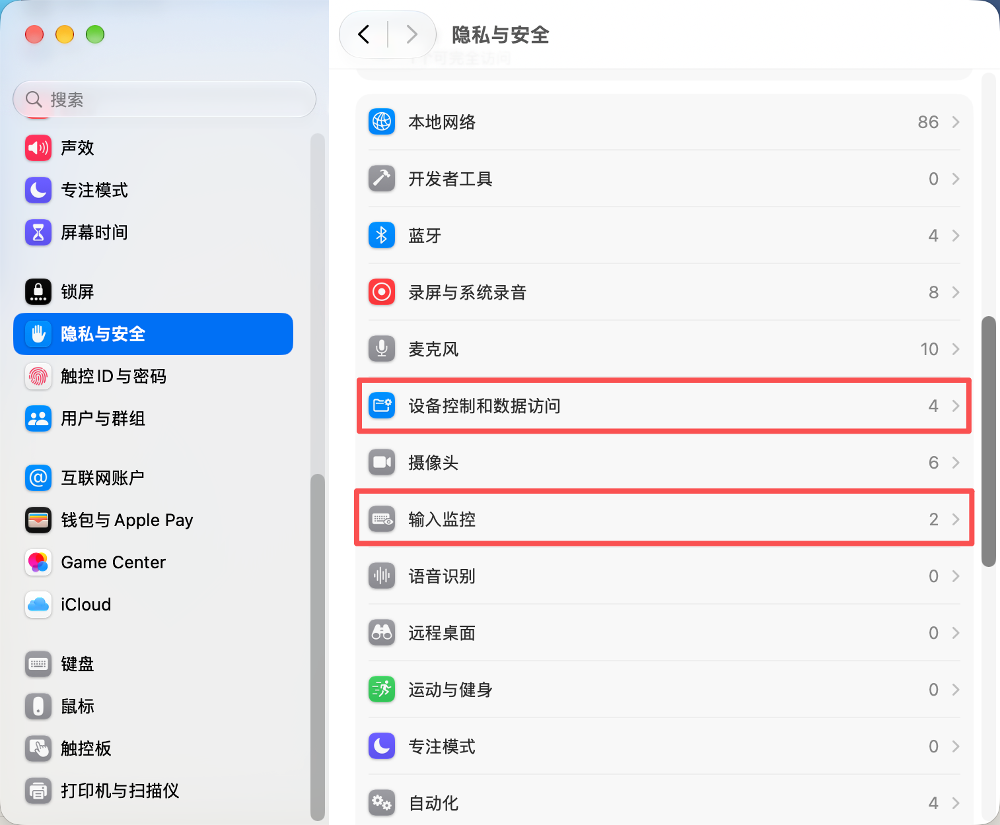

# 鼠标侧切 · SideMouse

原生 macOS 应用，只将 G309 的两个侧键映射成 Control + 左右方向键。

- button 3 → Control + 右箭头
- button 4 → Control + 左箭头

映射已根据用户实测对调。程序只监听 otherMouseDown/otherMouseUp 中的两个侧键；其他按键、鼠标左/右键不进入事件监听器。两个侧键的按下和松开成对消费。事件回调不写文件、不等待。

输入监控和快捷键发送权限分别检测。窗口显示当前权限、监听及最近发送动作，“已发送”不表示系统必然切换。退出按钮直接停止进程。文件锁确保正常模式只有一个实例。

程序通过带 Control 修饰标志的方向键事件切换桌面。Control 使用 flagsChanged 事件，方向键同时保留 NumericPad/SecondaryFn 标志，随后释放修饰键。发布使用原有 Developer ID 签名及 com.guaker.desktop-side-keys.v2 身份，避免更新后权限身份变化。

## 使用

安装、授权、登录启动和常见故障处理见[使用说明](使用说明.md)。

### 权限设置

在“系统设置 → 隐私与安全性”中为“鼠标侧切”开启以下两项权限：

- **输入监控**：监听鼠标侧键。
- **设备控制和数据访问**（部分 macOS 版本显示为“辅助功能”）：发送 Control + 左/右箭头快捷键。

桌面切换无需其他隐私权限。开启后退出并重新打开应用，确认两项权限显示“已允许”。

[查看完整图文授权步骤（含两项权限的开启截图）](使用说明.md#需要开启的两项权限)。

## 本机安装信息

- 应用：/Applications/SideMouse.app
- 源码：项目目录
- 登录启动项：~/Library/LaunchAgents/com.guaker.desktop-side-keys.plist

登录时带 --background 启动，不显示窗口。关闭窗口继续运行，“退出”停止映射；退出后不会自动拉起，下一次登录启动。

## 编译与验证

运行 ./build.sh，只在临时目录构建并校验签名，不覆盖安装版本。

应用带独立诊断模式 --verify-shortcuts 和 --verify-mapping，观察当前桌面编号，测试快捷键或模拟两个侧键，并切回原桌面后退出；不会修改系统快捷键或使用私有 API 来切换桌面。Spaces 私有接口只用于读取诊断结果。

2026-11-08 本机验证：

- 修正键盘标志后，Control+左箭头：50 → 28；右箭头：28 → 50。
- 完整侧键链路验证通过，用户确认实体鼠标两个侧键均可切换。
- 方向按用户要求对调后，button 3：28 → 50；button 4：50 → 28。

不调用 tccutil，不修改系统权限数据库，不写入系统快捷键配置。

中文名：鼠标侧切。英文名：SideMouse。图标：蓝色圆角底、白色鼠标、青色双侧键及左右箭头。名称按系统语言显示，应用标识及签名保持一致。
