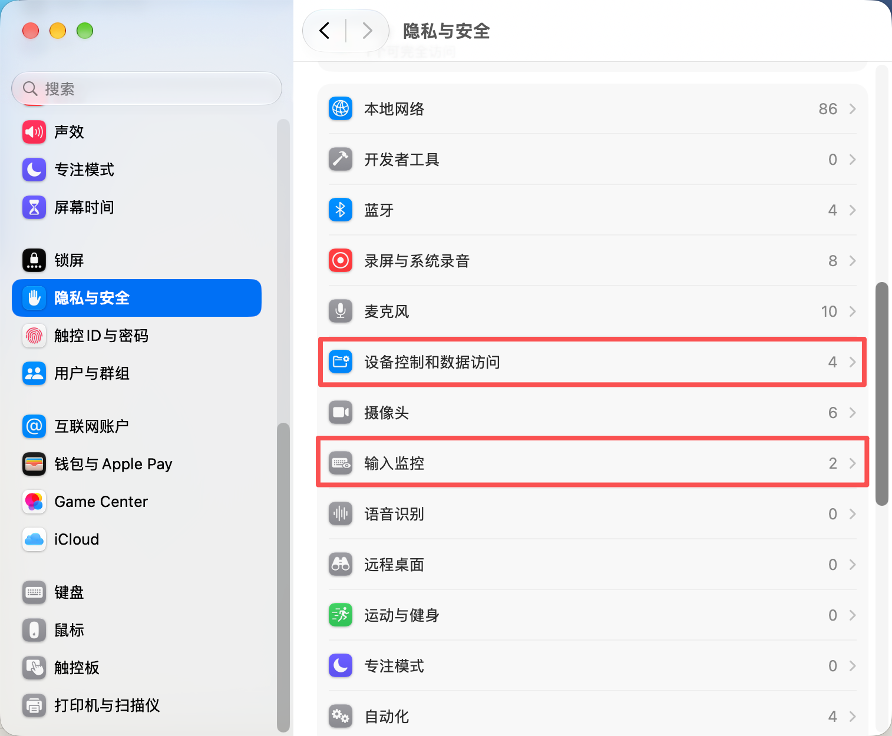
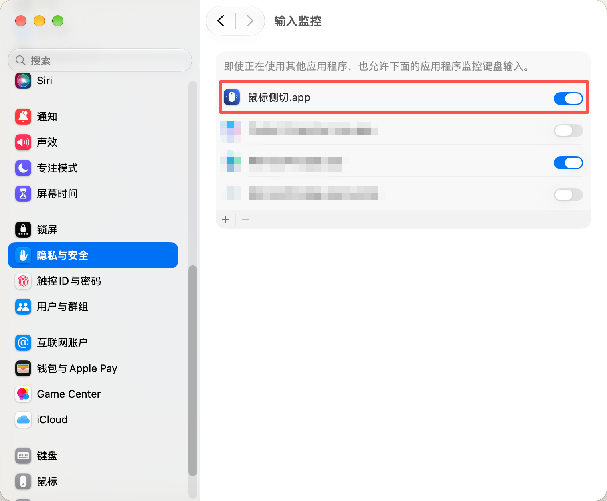
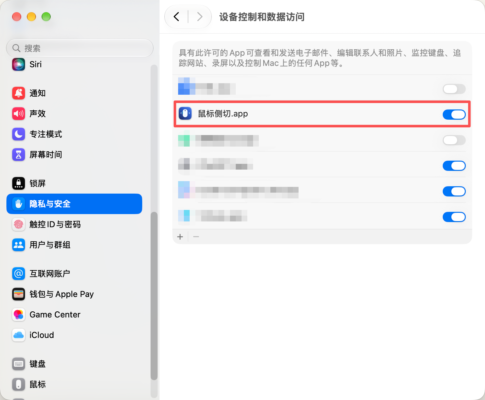

# 使用说明

## 安装

将 `SideMouse.app` 拖入“应用程序”，打开“鼠标侧切”。

## 权限设置

在“系统设置 → 隐私与安全性”中开启以下两项权限：

| 权限 | 用途 |
| --- | --- |
| 输入监控 | 监听鼠标侧键 |
| 设备控制和数据访问（部分系统显示为“辅助功能”） | 发送 Control + 左/右箭头 |

只需这两项隐私权限。列表中没有应用时，点击“＋”，从“应用程序”中添加 `SideMouse.app`。

### 1. 找到权限入口

### 2. 开启输入监控

打开“鼠标侧切.app”右侧开关。

### 3. 开启设备控制和数据访问

打开“鼠标侧切.app”右侧开关。部分系统中此页面名为“辅助功能”。

授权后退出并重新打开应用，确认两项权限均为“已允许”、侧键监听为“运行中”。

## 使用与启动

- 侧键 3：Control + →，切换到右侧桌面。
- 侧键 4：Control + ←，切换到左侧桌面。
- 关闭窗口继续运行；点击“退出”停止映射。
- 自动启动：在“系统设置 → 通用 → 登录项”中添加 `SideMouse.app`。

## 无法切换

1. 检查两项权限是否开启，授权后重新打开应用。
2. 确认已创建多个桌面，且实体键盘的 Control + 左/右箭头可以切换。
3. 检查“系统设置 → 键盘 → 键盘快捷键 → 调度中心”中的桌面切换快捷键。

窗口显示“已发送”表示快捷键已发出，实际切换取决于系统快捷键及桌面位置。
